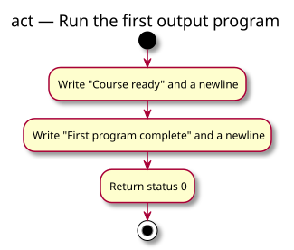

# Activity diagram — foundation practice pack — first output

> Source specification: [Foundation practice pack](../../specs/foundation-practice-pack.md), FO-R1–FO-R3.
> Status: detailed conception awaiting owner validation.

## Context

This activity models one execution of the first console program. It shows observable runtime actions and the success return; preprocessing and compilation remain outside the activity.

## Diagram

[PlantUML source](01-activity-first-output.puml)

## Notes

- The two writes occur in the required order.
- Each message includes its own newline.
- Returning status 0 does not print another line.
- No decision, function decomposition, or structural diagram is needed.
