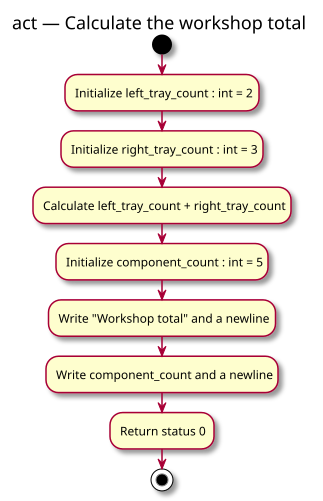

# Activity diagram — foundation practice pack — workshop total

> Source specification: [Foundation practice pack](../../specs/foundation-practice-pack.md), WT-R1–WT-R3.
> Status: detailed conception awaiting owner validation.

## Context

This activity separates the learner's calculation and storage reasoning. It does not prescribe processor instructions or a meaningful ordering between the two side-effect-free operand reads.

## Diagram

[PlantUML source](02-activity-workshop-total.puml)

## Notes

- Both tray counts exist before the total expression reads them.
- Calculating the total does not modify either tray count.
- `component_count` stores 5 rather than a live formula.
- Output exposes the stored result without introducing input parsing.
