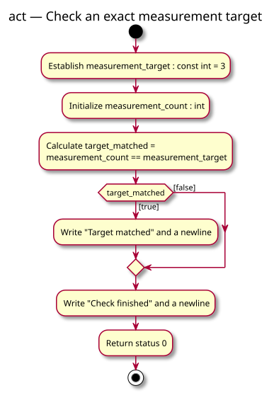

# Activity diagram — foundation practice pack — target check

> Source specification: [Foundation practice pack](../../specs/foundation-practice-pack.md), TC-R1–TC-R4.
> Status: approved by the owner before implementation; implemented locally.

## Context

This activity models one execution with a count written in the source. The same activity covers the baseline value 3 and the learner variations 2 and 4; it does not model repeated measurements.

## Diagram

[PlantUML source](03-activity-target-check.puml)

## Notes

- Equality is calculated once before the decision.
- Only the true path writes `Target matched`.
- Both paths join before `Check finished`.
- A false result includes values below and above the target.
